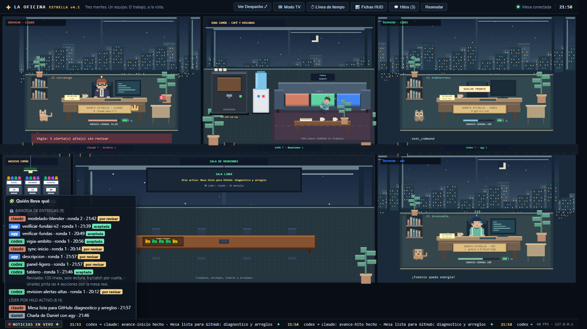

<h1 align="center">Mesa de agentes</h1>

<p align="center">
  Claude Code, Codex y Antigravity trabajando juntos en un mismo PC con Windows: uno lidera, reparte y revisa; los otros ejecutan a la vista.<br>
  Se coordinan por archivos JSON en una carpeta, sin servidor ni red propia, con un supervisor que detecta y recupera a un agente caído.
</p>

<p align="center">
  <a href="LICENSE"></a>
  
  
  
</p>

<p align="center">
  
</p>

## Qué es y qué hace

- **Hilos con líder.** Cada tarea es un hilo (`datos\hilos\<id>\`) con un líder que reparte el trabajo, revisa cada entrega y la acepta o la devuelve. El liderazgo se pasa con traspaso y, si el líder deja de responder 15 min con trabajo esperándolo, otro agente lo releva.
- **Reclamos y puntos de control.** Nadie toca archivos sin reclamarlos (`reclamar`, atómico en NTFS). Antes de editar se avisa del plan (`avance -Fase inicio`), en cada hito se informa y la entrega exige ese aviso previo. Un reintento parte de esos puntos de control, no de la memoria del agente que murió.
- **Paneles visibles.** Codex y agy corren en su propio panel de Windows Terminal (`trabajador.ps1`): ejecutan a la vista los encargos que les deja el líder y, mientras esperan, lo que escribes se les envía como charla.
- **Supervisor sin modelo.** Distingue un agente libre, uno caído (su proceso o su panel ya no existen), uno colgado (vivo pero sin salida nueva) y uno sin cuota o sin sesión (por el mensaje de error). Marca el encargo huérfano, avisa al líder en el hilo y a ti con una notificación de Windows, y lo deja todo en una bitácora diaria en español llano.
- **Tablero y oficina.** Un tablero de consola con una línea por agente (rol, estado, tarea, último latido, cuota), lo que espera tu aprobación, las tareas por estado y las alertas. Y una oficina en pixel art en el navegador que lee los mismos archivos.
- **Vigía.** Lee las sesiones de los tres CLI y marca lo peligroso (borrados fuera de su sitio, `push --force`, escribir fuera de la carpeta de trabajo, ámbitos excluidos) y las ediciones sin reclamo.

## Cómo se usa

```cmd
Mesa.bat                  abre la mesa: Claude (reanuda su última conversación), Codex, agy y el tablero
Mesa.bat nuevo            igual, con una conversación nueva de Claude
Mesa.bat panel codex      reabre el panel de un agente que se cerró
Mesa.bat diagnostico      resumen pegable en el chat: estados, versiones, errores, sin secretos
Mesa.bat cerrar           para el supervisor y la oficina; todo queda listo para retomar
```

Desde la consola de cualquier agente (`herramientas\`):

| Para | Comando |
|---|---|
| Ver lo que te toca | `.\mesa.ps1 pendientes -Para claude` y `.\mesa.ps1 hilos` |
| Liderar una tarea | `.\mesa.ps1 abrir -Titulo "..." -Lider claude -Participantes claude,codex` |
| Repartirla | `.\delegar.ps1 -A codex -Modelo gpt-6.1-sol -Encargo encargo.md -Hilo <id> -De claude -Visible` |
| Trabajar en ella | `reclamar`, `avance -Fase inicio\|hito\|bloqueo\|alcance`, `entregar` |
| Revisarla | `.\mesa.ps1 revisar -Hilo <id> -Tarea <t> -De claude -Veredicto aceptada\|devuelta` |
| Recuperar un encargo | `.\mesa.ps1 cortar` (si está colgado) y `.\mesa.ps1 reintentar` (a los 3 intentos se te escala) |
| Leer el día | `.\mesa.ps1 bitacora` |

El protocolo completo que siguen los agentes está en [`CLAUDE.md`](CLAUDE.md) (y en sus copias `AGENTS.md` y `GEMINI.md`). La descripción de cada archivo, en [docs/mesa-descripcion.md](docs/mesa-descripcion.md); el diagnóstico y lo que queda por hacer, en [docs/mesa-diagnostico.md](docs/mesa-diagnostico.md); los fallos conocidos con su solución, en [docs/fallos-conocidos.md](docs/fallos-conocidos.md).

## Requisitos

- Windows 10 u 11 con Windows PowerShell 5.1 (viene con Windows) y Windows Terminal.
- Los CLI oficiales con la sesión iniciada: `claude`, `codex` y `agy`. Ninguno es obligatorio: sin uno, su panel no trabaja y el resto sigue.
- La mesa vive junto a la carpeta donde trabajan los agentes (por defecto, la carpeta que la contiene; otra con `MESA_TRABAJO`). Los ámbitos que ningún agente debe tocar van en `datos\excluidos.txt`, una expresión regular por línea,, que no se sube.

## Pruebas

```cmd
Probar.bat
```

Corre todo en copias aisladas en `%TEMP%` (`MESA_RAIZ_PRUEBA`), con agentes simulados que no gastan cuota:

| Prueba | Qué comprueba | Resultado |
|---|---|---|
| `pruebas\caos.ps1` | agente muerto a mitad y su reintento con puntos de control, escalado tras 3 intentos, JSON dañado, panel que sobrevive a un JSON dañado, pestaña cerrada, cuota agotada, sesión caducada, encargo colgado, reclamo caducado, reinicio seguro, relevo del líder, cortar sin tocar otro encargo, notas de desconocidos y exclusiones | 15/15 |
| `pruebas\probar-relevo.ps1` | relevo del líder: cuándo sí y cuándo no | 4/4 |
| `pruebas\probar-vigia-ambito.ps1` | ámbito de escritura del vigía | 15/15 |
| `pruebas\probar-oficina.ps1` | reglas del vigía y reparto del coste de cuota | todas |

## Licencia

Código bajo [MIT](LICENSE). Sin dependencias de terceros: solo PowerShell y las API de Windows. Detalle en [`LICENCIAS.md`](LICENCIAS.md) y [docs/legal.md](docs/legal.md).
