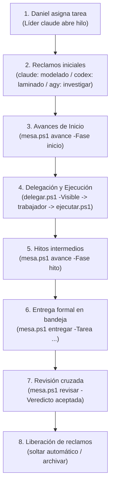

# Descripción técnica y operativa de la Mesa de agentes

> Describe la mesa tal como estaba el 19-oct-2026 **antes** de la ronda de arreglos (redactado por agy y revisado por claude). Lo que cambió después —supervisor, tablero, `Mesa.bat`, pruebas en `pruebas\`, rutas sin escribir a mano— está en [mesa-diagnostico.md](mesa-diagnostico.md), columna «Ahora».

Documento de referencia técnica del sistema multi-agente «Mesa de agentes», compuesto por **claude** (Claude Code), **codex** (Codex CLI) y **agy** (Antigravity CLI), coordinados sobre Windows 11 en PowerShell 5.1 sin servicios externos de orquestación ni bases de datos centralizadas.

---

## 1. Árbol de carpetas y archivos con el propósito de cada uno

La arquitectura de la Mesa reside íntegramente en el sistema de archivos local bajo la raíz `D:\Programas de uso libre\mesa-agentes\`.

```
mesa-agentes\
├── Abrir-Mesa.bat               # Lanzador Windows Terminal: arranca servidor web y paneles de agentes
├── AGENTS.md                    # Reglas operativas del protocolo de coordinación (copia unificada)
├── CLAUDE.md                    # Copia idéntica de AGENTS.md (leída por claude)
├── GEMINI.md                    # Copia idéntica de AGENTS.md (leída por agy)
├── LEEME.md                     # Resumen de bienvenida, principios y reglas del espacio de trabajo
├── .gitignore                   # Exclusión de archivos volátiles, bloqueos, perfiles y datos temporales
│
├── herramientas\                # Scripts PowerShell de coordinación, ejecución y observabilidad
│   ├── comun.ps1                # Biblioteca base: rutas, candados, JSON seguro, contadores y normalización
│   ├── costes.ps1               # Cálculo de ponderación de costes de tokens y desgaste por modelo
│   ├── cuota.ps1                # Monitoreo, lectura y consolidación de cuotas oficiales y estimadas
│   ├── delegar.ps1              # Atajo para abrir hilos, formalizar encargos y encolarlos (-Visible)
│   ├── ejecutar.ps1             # Motor de invocación de los CLIs (claude, codex, agy) y captura de logs
│   ├── esperar-novedades.ps1    # Sondeo bloqueante para sesiones interactivas (despierta ante novedades)
│   ├── medir-claude.ps1         # Utilidad para computar consumo de tokens y caché de Claude Code
│   ├── mesa.ps1                 # CLI unificado de la Mesa: hilos, reclamos, avances, entregas y revisiones
│   ├── observatorio.ps1         # Consolidación de métricas de rendimiento, tiempos y calidad de entrega
│   ├── supervisor.ps1           # Supervisor de salud: detección de procesos huérfanos y encargos colgados
│   ├── tablero.ps1              # Monitor de consola en tiempo real (100 columnas, 4 secciones)
│   ├── tokens-calibrador.ps1    # Calibración empírica entre tokens registrados y consumo real
│   ├── trabajador.ps1           # Demonio de panel (-Agente): atiende cola de tareas y vigila relevos
│   └── vigia.ps1                # Auditor de seguridad: monitorea comandos y escrituras fuera de ámbito
│
├── panel\                       # Interfaz gráfica de usuario servida en navegador local
│   ├── servidor.ps1             # Servidor HTTP embebido (System.Net.HttpListener) en puerto dinámico
│   ├── estado.ps1               # Generador del estado reactivo del panel (estado-panel.json)
│   ├── index.html               # Frontend del panel (oficina virtual isométrica, corcho, hilos, entregas)
│   ├── oficina.js               # Lógica del cliente web, polling cada 5 s y navegación entre despachos
│   ├── oficina.css              # Estilos visuales del panel oscuro, animaciones y modales
│   ├── arte-v1.js               # Sprites, mapas de losetas y recursos gráficos de avatares y muebles
│   ├── reclamos.js              # Módulo frontend para la representación de tareas y reclamos
│   └── puerto.txt               # Archivo plano con el puerto TCP donde escucha el servidor HTTP
│
├── datos\                       # Almacén de estado persistente basado en archivos JSON y JSONL
│   ├── hilos\                   # Directorio con un subdirectorio por cada hilo de trabajo (<id-hilo>)
│   │   └── <id-hilo>\
│   │       ├── hilo.json        # Metadatos del hilo: id, título, estado, líder y participantes
│   │       ├── NNNN-<autor>.json# Mensajes ordenados correlativos (encargos, notas, avances, entregas)
│   │       ├── entregas\        # Bandeja de entregas formales del hilo (<tarea>.json)
│   │       └── logs\            # Registros brutos de ejecución de cada llamada a los CLIs
│   ├── reclamos\                # Candados de exclusión mutua de tareas (<tarea>.json y lider.json)
│   ├── despachos\               # Configuración de despacho virtual por agente (agy.json, claude.json, codex.json)
│   ├── actividad.jsonl          # Log secuencial de todas las acciones y herramientas usadas por agentes
│   ├── vigia-estado.json        # Estado persistente del auditor de seguridad (últimas lecturas e índices)
│   ├── estado-panel.json        # Instantánea completa generada para el consumo del dashboard web
│   ├── alertas.jsonl            # Registro de alertas de seguridad y anomalías detectadas
│   ├── cuota-fotos.jsonl        # Historial de mediciones directas y fotos de cuotas
│   ├── registro-tokens.jsonl    # Histórico de tokens y duración de cada ejecución de agentes
│   ├── alertas-revisadas.json   # Lista de identificadores de alertas atendidas por Daniel o líderes
│   ├── cuota-estado.json        # Consolidado actualizado de estado de cuotas de los tres agentes
│   ├── aprobaciones.log         # Registro tabulado (TSV) de encargos aprobados y decoraciones
│   ├── personajes.json          # Configuración estética y posiciones de avatares en el panel
│   ├── cuota-calibracion.json   # Factores de conversión y desgaste por token/modelo
│   ├── mesa.json                # Configuración operativa: topes por hora/día, modelos y autoaprobaciones
│   ├── sesion-<agente>.txt      # Identificador de la conversación activa de cada agente para charla
│   └── trabajador-<agente>.latido # Marca temporal ISO del último pulso de vida de cada trabajador
│
├── diseno\                      # Especificaciones de arquitectura, encargos de interfaz y capturas
│   └── pruebas\                 # Scripts de prueba y automatización con Edge headless (Puppeteer/CJS)
│
└── anteriores\                  # Archivo histórico versionado por fechas (2026-10-17, 2026-10-18-*)
```

### Tamaños aproximados de los archivos de `datos\` que más crecen (medición real en producción)
1. `datos\actividad.jsonl`: **3.681.499 bytes (~3,68 MB)**. Recibe un registro JSON por cada herramienta o comando ejecutado por cualquier agente; no tiene política de rotación automática.
2. `datos\vigia-estado.json`: **1.262.043 bytes (~1,26 MB)**. Almacena el árbol de índices analizados por el vigía; crece de forma continua al acumular sesiones.
3. `datos\estado-panel.json`: **566.332 bytes (~566 KB)**. Fotografía consolidada de toda la Mesa generada en segundo plano por `panel\servidor.ps1:42` cada pocos segundos.
4. `datos\alertas.jsonl`: **121.814 bytes (~122 KB)**. Eventos anómalos o advertencias de seguridad generadas por el vigía.
5. `datos\cuota-fotos.jsonl`: **19.795 bytes (~20 KB)**.
6. `datos\registro-tokens.jsonl`: **13.870 bytes (~14 KB)**.
7. `datos\alertas-revisadas.json`: **8.455 bytes (~8,5 KB)**.
8. `datos\cuota-estado.json`: **6.449 bytes (~6,4 KB)**.
9. `datos\aprobaciones.log`: **5.342 bytes (~5,3 KB)**.

---

## 2. Formato de cada tipo de archivo con un ejemplo real anonimizado

Todos los textos y descripciones extensas han sido recortados a un máximo de 200 caracteres para claridad, eliminando rutas personales ajenas a `D:\Programas de uso libre` y cualquier dato confidencial.

### 2.1 Mensajes de hilo (`datos\hilos\<id>\NNNN-autor.json`)
Cada mensaje se almacena en un archivo JSON numerado correlativamente con formato de cuatro dígitos (`0001-claude.json`).

#### Tipo `encargo` (asignación de trabajo delegada por el líder)
Ejemplo real: `datos\hilos\20261019-mesa-lista-para-github-d\0008-claude.json`:
```json
{
  "n": 8,
  "autor": "claude",
  "para": "agy",
  "herramienta": "agy",
  "modelo": "gemini-3.8-flash-high",
  "fecha": "2026-10-19T21:46:10-05:00",
  "tipo": "encargo",
  "texto": "Delegación a agy (gemini-3.8-flash-high): encargo-agy-descripcion.md",
  "encargo": "D:\\Programas de uso libre\\mesa-agentes\\diseno\\encargo-agy-descripcion.md",
  "dir": "D:\\Programas de uso libre\\mesa-agentes",
  "estado": "ejecutando",
  "traspaso": {
    "hecho": "autoaprobado",
    "falta": "",
    "archivos": [
      "D:\\Programas de uso libre\\mesa-agentes\\diseno\\encargo-agy-descripcion.md"
    ]
  },
  "llamada": {
    "inicio": "2026-10-19T21:46:25-05:00",
    "fin": null,
    "salida": null,
    "log": "D:\\Programas de uso libre\\mesa-agentes\\datos\\hilos\\20261019-mesa-lista-para-github-d\\logs\\0008-agy.log",
    "pid": 38712
  },
  "esfuerzo": "medium",
  "cola": true
}
```

#### Tipo `respuesta` (conclusión técnica devuelta tras ejecutar un encargo)
Ejemplo real: `datos\hilos\20261019-mesa-lista-para-github-d\0011-codex.json`:
```json
{
  "n": 11,
  "autor": "codex",
  "para": "claude",
  "herramienta": "codex",
  "modelo": "gpt-6.1-sol",
  "fecha": "2026-10-19T21:46:28-05:00",
  "tipo": "respuesta",
  "texto": "Implementado [tablero.ps1]: 135 líneas, cuatro secciones, colores y refresco configurable. Verificado en PowerShell 5.1 con datos reales, JSON corrupto y archivo bloqueado. No modifica datos...",
  "encargo": null,
  "dir": "D:\\Programas de uso libre\\mesa-agentes",
  "estado": "hecho",
  "traspaso": {
    "hecho": "Implementado [tablero.ps1]: 135 líneas, cuatro secciones...",
    "falta": "",
    "archivos": [
      "D:\\Programas de uso libre\\mesa-agentes\\datos\\hilos\\20261019-mesa-lista-para-github-d\\logs\\0002-codex.log",
      "D:\\Programas de uso libre\\mesa-agentes\\datos\\hilos\\20261019-mesa-lista-para-github-d\\logs\\0002-codex-final.txt"
    ]
  },
  "llamada": { "inicio": null, "fin": null, "salida": null, "log": null }
}
```

#### Tipo `nota` (comunicación directa entre agentes sin ejecución)
Ejemplo real: `datos\hilos\20261019-mesa-lista-para-github-d\0004-agy.json`:
```json
{
  "n": 4,
  "autor": "agy",
  "para": "claude",
  "herramienta": null,
  "modelo": null,
  "fecha": "2026-10-19T21:45:23-05:00",
  "tipo": "nota",
  "texto": "Hola Claude. Estoy libre y con capacidad activa para apoyar en las tareas de preparación de mesa-agentes para GitHub...",
  "encargo": null,
  "dir": "D:\\Programas de uso libre\\mesa-agentes",
  "estado": "hecho",
  "traspaso": { "hecho": "Mensaje registrado", "falta": "", "archivos": [] },
  "llamada": { "inicio": null, "fin": null, "salida": null, "log": null }
}
```

#### Tipo `avance-inicio` (punto de control obligatorio antes de editar)
Ejemplo real: `datos\hilos\20261019-mesa-lista-para-github-d\0012-agy.json`:
```json
{
  "tarea": "descripcion",
  "n": 12,
  "autor": "agy",
  "para": "claude",
  "herramienta": null,
  "modelo": null,
  "fecha": "2026-10-19T21:46:45-05:00",
  "tipo": "avance-inicio",
  "texto": "[INICIO] descripcion (archivos: docs\\mesa-descripcion.md): Inicio de redacción de docs\\mesa-descripcion.md cubriendo las 8 secciones obligatorias con evidencias y archivo:línea.",
  "encargo": null,
  "dir": "D:\\Programas de uso libre\\mesa-agentes",
  "estado": "hecho",
  "traspaso": { "hecho": "[INICIO] descripcion...", "falta": "", "archivos": [] },
  "llamada": { "inicio": null, "fin": null, "salida": null, "log": null }
}
```
*(Nota: los tipos `avance-hito`, `avance-bloqueo` y `avance-alcance` comparten esta estructura idéntica, variando el prefijo del tipo y del texto).*

#### Tipo `entrega` (anuncio formal de entrega en el hilo)
Ejemplo real: `datos\hilos\20261019-mesa-lista-para-github-d\0007-codex.json`:
```json
{
  "n": 7,
  "autor": "codex",
  "para": "claude",
  "herramienta": null,
  "modelo": null,
  "fecha": "2026-10-19T21:46:10-05:00",
  "tipo": "entrega",
  "texto": "Entrega 'tablero' (ronda 1) en la bandeja: Implementado herramientas\\tablero.ps1: cuatro secciones, refresco configurable (5 s), -UnaVez, colores y render en una escritura...",
  "encargo": null,
  "dir": "D:\\Programas de uso libre\\mesa-agentes",
  "estado": "hecho",
  "traspaso": {
    "hecho": "Entrega 'tablero' (ronda 1)...",
    "falta": "",
    "archivos": [
      "D:\\Programas de uso libre\\mesa-agentes\\datos\\hilos\\20261019-mesa-lista-para-github-d\\entregas\\tablero.json"
    ]
  },
  "llamada": { "inicio": null, "fin": null, "salida": null, "log": null }
}
```

#### Tipo `revision` (resolución del líder aceptando o devolviendo una entrega)
Ejemplo real: `datos\hilos\20261018-cubre-jeringas-10-ml-inf\0040-claude.json`:
```json
{
  "tarea": "verificar-fundas-v2",
  "n": 40,
  "autor": "claude",
  "para": "agy",
  "herramienta": null,
  "modelo": null,
  "fecha": "2026-10-18T21:39:51-05:00",
  "tipo": "revision",
  "texto": "Entrega 'verificar-fundas-v2' ACEPTADA.",
  "encargo": null,
  "dir": "D:\\Programas de uso libre\\mesa-agentes",
  "estado": "hecho",
  "traspaso": {
    "hecho": "Entrega 'verificar-fundas-v2' ACEPTADA.",
    "falta": "",
    "archivos": [
      "D:\\Programas de uso libre\\mesa-agentes\\datos\\hilos\\20261018-cubre-jeringas-10-ml-inf\\entregas\\verificar-fundas-v2.json"
    ]
  },
  "llamada": { "inicio": null, "fin": null, "salida": null, "log": null }
}
```

#### Tipo `lider` (cambio de liderazgo registrado en el hilo)
Ejemplo real adaptado de `mesa.ps1:610-634`:
```json
{
  "n": 9,
  "autor": "daniel",
  "para": "claude",
  "herramienta": null,
  "modelo": null,
  "fecha": "2026-10-18T10:06:20-05:00",
  "tipo": "lider",
  "texto": "Cambio de líder de codex a claude",
  "encargo": null,
  "dir": "D:\\Programas de uso libre\\mesa-agentes",
  "estado": "hecho",
  "traspaso": { "hecho": "Líder actualizado a claude", "falta": "", "archivos": [] },
  "llamada": { "inicio": null, "fin": null, "salida": null, "log": null }
}
```

---

### 2.2 Metadatos del hilo (`datos\hilos\<id>\hilo.json`)
Ejemplo real: `datos\hilos\20261019-mesa-lista-para-github-d\hilo.json`:
```json
{
  "id": "20261019-mesa-lista-para-github-d",
  "titulo": "Mesa lista para GitHub: diagnostico y arreglos",
  "estado": "abierto",
  "lider": "claude",
  "participantes": [
    "claude",
    "codex",
    "agy"
  ],
  "creado": "2026-10-19T21:41:18-05:00",
  "actualizado": "2026-10-19T21:52:49-05:00",
  "tareas": [
    "tablero"
  ]
}
```
> [!IMPORTANT]
> El rol de líder de un hilo vive simultáneamente en `hilo.json` (campo `"lider"`) y en el reclamo especial `datos\reclamos\lider.json` en caso de hilos activos de coordinación global.

---

### 2.3 Reclamo de tarea (`datos\reclamos\<tarea>.json`)
Los reclamos evitan que dos agentes colisionen editando los mismos archivos. La creación con `[IO.File]::Open($ruta, 'CreateNew', 'Write', 'None')` (`mesa.ps1:159`) garantiza atomicidad NTFS.

Ejemplo ordinario (`datos\reclamos\mesa-github.json`):
```json
{"tarea":"mesa-github","agente":"claude","fecha":"2026-10-19T21:52:29-05:00","hilo":"20261019-mesa-lista-para-github-d","toca":"herramientas\\comun.ps1; herramientas\\mesa.ps1; herramientas\\trabajador.ps1; herramientas\\ejecutar.ps1; herramientas\\delegar.ps1; herramientas\\supervisor.ps1; panel\\estado.ps1; docs\\*; README.md"}
```

Ejemplo del reclamo especial de líder (`datos\reclamos\lider.json`):
```json
{"tarea":"lider","agente":"claude","fecha":"2026-10-18T10:06:20-05:00","hilo":"20261018-prueba-de-coordinacion-p","toca":"integración y revisión; confirmado por codex en #8"}
```

---

### 2.4 Entrega de tarea (`datos\hilos\<id>\entregas\<tarea>.json`)
Archivo persistente en la subcarpeta `entregas\` del hilo. Nunca se elimina; el archivo final solo cambia `"estado": "archivada"`.

Ejemplo real: `datos\hilos\20261019-mesa-lista-para-github-d\entregas\tablero.json`:
```json
{
  "hilo": "20261019-mesa-lista-para-github-d",
  "tarea": "tablero",
  "autor": "codex",
  "estado": "aceptada",
  "fecha": "2026-10-19T21:46:10-05:00",
  "ronda": 1,
  "resumen": "Implementado herramientas\\tablero.ps1: cuatro secciones, refresco configurable (5 s), -UnaVez, colores y render en una escritura; lectura tolerante a corrupción y bloqueo; solo lectura de datos. 135 líneas.",
  "pruebas": "PowerShell 5.1, ambas salidas con código 0. Archivo bloqueado: código 0 y aviso gris. Hashes de datos aislados idénticos antes/después; líneas visibles <=100 columnas; script 135 líneas...",
  "pendientes": "",
  "archivos": [
    "herramientas\\tablero.ps1"
  ],
  "revisor": "claude",
  "motivo": "Revisado: 135 lineas, solo lectura, try/catch por vuelta, -UnaVez pinta las 4 secciones con la mesa real.",
  "revisado": "2026-10-19T21:52:29-05:00",
  "archivada": null
}
```

---

### 2.5 Línea de actividad (`datos\actividad.jsonl`)
Registro secuencial en formato JSON Lines escrito bajo candado por el vigía ante cada herramienta invocada:
```json
{"agente":"claude","modelo":"claude-opus-5-5","hora":"2026-10-18T02:11:10.783Z","tipo":"comando","valor":"sleep 45; cd \"/d/Programas de uso libre/mesa-agentes/datos/hilos/20261017-encargo-encargo-oficina\" && grep -ho '\"estado\"[^,]*' 0*.json; ls -la logs | tail -2","herramienta":"Bash","operacion":"ejecucion"}
```

---

### 2.6 Línea de alerta (`datos\alertas.jsonl`)
Registro secuencial de eventos sospechosos o violaciones de ámbito detectadas por el vigía:
```json
{"agente":"codex","modelo":"desconocido","hora":"2026-10-18T02:31:45.292Z","tipo":"comando","valor":"$codificacion=New-Object Text.UTF8Encoding $true; Get-ChildItem -LiteralPath herramientas,panel -Filter *.ps1 -File | ForEach-Object { $t=[IO.File]::ReadAllText($_.FullName); ...","herramienta":"exec_command","operacion":"ejecucion","id":"de0ab2e21b60","nivel":"medio","motivo":"Detención masiva de procesos"}
```

---

### 2.7 Registro de aprobaciones (`datos\aprobaciones.log`)
Registro tabulado (TSV) con marcas de tiempo ISO:
```tsv
2026-10-17T19:26:00-05:00	APROBADO	hilo=20261017-encargo-encargo-auditori	n=1	de=claude	para=agy	modelo=gemini-3.8-flash-high	motivo=autoaprobado
2026-10-17T21:10:38-05:00	APROBADO	hilo=20261017-encargo-encargo-oficina	n=1	de=claude	para=codex	modelo=gpt-6-astra	motivo=autoaprobado
```

---

### 2.8 Latido de trabajador (`datos\trabajador-<agente>.latido`)
Archivo de texto plano de 25 bytes con la marca de tiempo ISO 8601 del último ciclo del panel:
```
2026-10-19T21:54:19-05:00
```

---

### 2.9 Archivo de sesión (`datos\sesion-<agente>.txt`)
Archivo de texto plano de 36 bytes que preserva el identificador UUID para encadenar conversaciones:
```
01a15731-880f-7320-94a3-e0806a4c5c6a
```

---

### 2.10 Configuración global (`datos\mesa.json`)
Estructura JSON que rige topes, autoaprobaciones y modelos:
```json
{
  "topes": {
    "codex": { "hora": 4, "dia": 20 },
    "agy": { "hora": 6, "dia": 30 },
    "claude": { "hora": 3, "dia": 10 }
  },
  "autoaprobar": [
    "Claude_nodo", "claude", "codex", "agy", "antigravity"
  ],
  "modelos": {
    "codex": [ "gpt-6.1-sol", "gpt-6-astra", "gpt-6-luna" ],
    "agy": [ "gemini-3.8-flash-high", "gemini-4-argon-high" ],
    "claude": [ "fable", "opus", "sonnet", "haiku" ]
  },
  "supervisor": {
    "relanzar": false,
    "max_relanzar": 3,
    "ventana_min": 10,
    "colgado_min": 30,
    "reclamo_min": 60,
    "latido_seg": 90,
    "max_intentos": 3
  }
}
```

---

### 2.11 Estructura de cuotas (`datos\cuota-estado.json`)
Consolidado jerárquico estructurado en tres bloques principales:
- `codex`: mediciones oficiales leídas de los metadatos de sesión (`cinco_horas_usado_pct`, `semanal_usado_pct`, `cinco_horas_reinicia`, `semanal_reinicia`).
- `claude`: consumo estimado de tokens observados (`tokens_hoy`, `tokens_5h`, `tokens_7d`, `cache_read_7d`), porcentaje semanal estimado (`semanal_libre_pct_estimado`) y fechas de reinicio.
- `agy`: estructurado en subgrupos de modelos (`flash`, `argon`, `claude_gpt`) con desglose de porcentaje semanal libre oficial (`libre_pct_oficial`), ventana de 5 horas (`cinco_h_libre_pct_oficial`), fechas de reinicio y estimación de tareas restantes.

---

## 3. Cómo se entera cada CLI de que hay trabajo

### Ausencia total de hooks en las herramientas CLI
Ninguno de los tres clientes de IA dispone de webhooks ni disparadores automáticos configurados en sus entornos de usuario:
- **Claude Code**: `~\.claude\settings.json` carece de bloque `"hooks"`.
- **Codex CLI**: `~\.codex\config.toml` carece de cualquier definición de hooks o listeners externos.
- **Antigravity (agy)**: `~\.gemini\antigravity-cli\settings.json` carece de directivas `"hooks"`.

### Todo el sistema opera por sondeo periódico (Polling)
Para que los agentes se enteren del trabajo sin intervención manual continua, la Mesa implementa tres bucles de sondeo activos:

#### 1. Sesiones interactivas: `herramientas\esperar-novedades.ps1`
Se ejecuta en segundo plano en la sesión interactiva del agente. Bloquea el proceso y sondea el directorio `$Global:Mesa_Hilos` cada 15 segundos hasta un máximo de 55 minutos:
```powershell
# esperar-novedades.ps1:13-26

> Describe la mesa tal como estaba el 19-oct-2026 **antes** de la ronda de arreglos (redactado por agy y revisado por claude). Lo que cambió después —supervisor, tablero, `Mesa.bat`, pruebas en `pruebas\`, rutas sin escribir a mano— está en [mesa-diagnostico.md](mesa-diagnostico.md), columna «Ahora».
while ((Get-Date) -lt $fin) {
  Start-Sleep -Seconds $Intervalo
  $nuevos = @(Get-ChildItem -LiteralPath $Global:Mesa_Hilos -Recurse -Filter '*-*.json' -ErrorAction SilentlyContinue |
    Where-Object { $_.LastWriteTime -gt $desde -and $_.Directory.Name -ne 'logs' } | ForEach-Object {
      $m = Mesa-LeerMensaje $_.FullName
      if ($m -and $m.tipo -ne 'encargo' -and (Mesa-NormalizarHerramienta $m.autor) -ne $yo -and
          ($m.tipo -in @('avance-inicio', 'avance-alcance', 'avance-bloqueo', 'lider') -or
           @(([string]$m.para) -split '[,;]' | Where-Object { (Mesa-NormalizarHerramienta $_.Trim()) -eq $yo -or $_.Trim() -eq 'todos' }).Count)) {
        $t = [string]$m.texto
        '{0} #{1} {2} -> {3} [{4}]: {5}' -f $_.Directory.Name, $m.n, $m.autor, $m.para, $m.tipo, $(if ($t.Length -gt 600) { $t.Substring(0, 600) + '…' } else { $t })
      }
    })
  if ($nuevos.Count) { 'NOVEDADES PARA ' + $yo; $nuevos; exit 0 }
}
```

#### 2. Paneles de ejecución visual: `herramientas\trabajador.ps1 -Agente <yo>`
Los paneles dedicados de terminal ejecutan un ciclo continuo (`trabajador.ps1:103-135`) con un intervalo por defecto de 3 segundos (`$Intervalo = 3`). Cada 3 segundos invoca `Siguiente-EnCola`:
```powershell
# trabajador.ps1:18-28

> Describe la mesa tal como estaba el 19-oct-2026 **antes** de la ronda de arreglos (redactado por agy y revisado por claude). Lo que cambió después —supervisor, tablero, `Mesa.bat`, pruebas en `pruebas\`, rutas sin escribir a mano— está en [mesa-diagnostico.md](mesa-diagnostico.md), columna «Ahora».
function Siguiente-EnCola {
  $cola = foreach ($d in @(Get-ChildItem -LiteralPath $Global:Mesa_Hilos -Directory -ErrorAction SilentlyContinue)) {
    foreach ($f in @(Get-ChildItem -LiteralPath $d.FullName -Filter '*-*.json' -ErrorAction SilentlyContinue)) {
      $m = try { Mesa-LeerJson $f.FullName } catch { $null }
      if ($m -and $m.tipo -eq 'encargo' -and $m.estado -eq 'aprobado' -and $m.PSObject.Properties['cola'] -and $m.cola -and (-not $Agente -or $m.herramienta -eq $Agente)) {
        [pscustomobject]@{ hilo = $d.Name; n = [int]$m.n; fecha = $m.fecha; para = $m.para; modelo = $m.modelo; texto = $m.texto }
      }
    }
  }
  @($cola | Sort-Object fecha) | Select-Object -First 1
}
```
Si encuentra una tarea aprobada con `cola = true`, la toma y la ejecuta en pantalla invocando `ejecutar.ps1 -Ver`.

#### 3. Delegación visible: `herramientas\delegar.ps1 -Visible`
Al delegar un encargo, `delegar.ps1:92-101` comprueba si el archivo de latido del trabajador (`trabajador-<agente>.latido`) se ha actualizado en los últimos 30 segundos. Si el panel está vivo, añade la propiedad `cola = true` al archivo JSON del mensaje en el hilo para que el panel del agente lo recoja automáticamente.

#### Instrucciones obligatorias idénticas (`CLAUDE.md`, `AGENTS.md`, `GEMINI.md`)
Los tres agentes comparten exactamente el mismo archivo (SHA256: `314DD0D5F3FBBB717DEB5AEBD2BB539B5ED93AF2EB50D2F7CFC454395BD14C85`). En él se estipula:
> «Daniel prueba la coordinación en cada mensaje, aunque no lo diga y aunque te escriba solo a ti. Antes de tocar un archivo:
> - Mira `.\mesa.ps1 pendientes -Para <yo>` y `.\mesa.ps1 hilos`. Si hay un hilo abierto con líder sobre lo mismo, no eres líder: avisa al líder en ese hilo (`enviar ... -SoloNota`) con lo que te pidió Daniel y lo que propones, y espera su reparto.
> - Si eres una sesión interactiva (no un panel), ten siempre en segundo plano `.\esperar-novedades.ps1 -Para <yo>`: te despierta cuando llega algo para ti; atiéndelo y vuelve a lanzarlo. Sin eso, no te enteras de nada hasta que Daniel te escribe.»

---

## 4. Cómo se elige y se cambia el líder

El liderazgo de un hilo otorga la potestad exclusiva de descomponer el trabajo, aprobar tareas, delegar encargos y dictar veredictos en la bandeja de entregas (`mesa.ps1:102-106, 385-387`).

### 1. Asignación inicial sin hilo previo
Si Daniel escribe directamente una instrucción a un agente y no existe un hilo abierto sobre ese ámbito, ese agente asume de forma inmediata el rol de **líder**, abriendo el hilo a su nombre:
```powershell
.\herramientas\mesa.ps1 abrir -Titulo "<tarea>" -Lider <yo> -Participantes "<yo>,<otros>"
```

### 2. Traspaso explícito de liderazgo (`mesa.ps1 lider`)
Cualquier líder puede ceder el liderazgo a otro participante en fases donde sus capacidades o cuotas encajen mejor (`mesa.ps1:591-636`). El comando actualiza `hilo.json` y genera un mensaje formal de auditoría de tipo `lider`:
```powershell
.\herramientas\mesa.ps1 lider -Hilo <id> -Nuevo <agente>
```

### 3. Sugerencia automatizada por cuotas (`mesa.ps1 sugerir-lider`)
El subcomando `mesa.ps1:132-144` analiza la fase del hilo frente a las cuotas disponibles en `cuota-estado.json`:
- **Fase de planificación, revisión o decisión**: sugiere `claude` si su cuota semanal libre estimada es $\ge 20\%$.
- **Fase de volumen, documentación o auditoría**: sugiere `agy` (modelo `flash`) si su cuota libre es $\ge 10\%$.
- **Fase de código y desarrollo normal**: sugiere `codex` si su capacidad de 5 horas disponible es $\ge 25\%$.

### 4. Relevo automático por abandono (`trabajador.ps1: Vigilar-Lideres`)
Para evitar que la Mesa se paralice si un líder muere o queda inactivo, los paneles de los agentes ejecutan `Vigilar-Lideres` cada minuto (`trabajador.ps1:53-84`):
1. **Condición de activación**: un hilo abierto tiene mensajes de tipo `entrega` o `avance-bloqueo` de otros participantes esperando respuesta del líder por más de 15 minutos (`$RelevoMin = 15`), y el líder actual no registra actividad en `actividad.jsonl` ni en su latido (`trabajador-<lider>.latido`) en los últimos 15 minutos (`Mesa-UltimaActividad:24-37`).
2. **Exclusión mutua de relevo**: para evitar que múltiples agentes intenten relevar al mismo tiempo, el primer panel intenta crear de forma atómica el archivo de bloqueo:
   ```powershell
   $candado = Join-Path $Global:Mesa_Raiz "reclamos\relevo-$($d.Name).lock"
   [IO.File]::Open($candado, 'CreateNew', 'Write').Dispose()
   ```
3. **Toma de mando**: el panel ganador asume el liderazgo con `mesa.ps1 lider -Hilo <id> -Nuevo <Agente>`, genera un archivo de encargo `relevo-<Agente>.md` con instrucciones para revisar las entregas pendientes y se lo autoasigna con `delegar.ps1 -Visible`.

---

## 5. Reparto de una tarea de principio a fin: ejemplo real paso a paso

Caso de estudio real extraído del hilo `20261018-cubre-jeringas-10-ml-inf` («Cubre-jeringas 10 mL infantiles para Creality Hi (PLA)»):



### Paso 1: Apertura del hilo
Claude recibe el encargo de diseñar y laminar cubre-jeringas pediátricos. Abre el hilo con los tres agentes como participantes (`mesa.ps1:324`):
```powershell
.\herramientas\mesa.ps1 abrir -Titulo "Cubre-jeringas 10 mL infantiles para Creality Hi (PLA)" -Lider claude -Participantes "claude,codex,agy"
```
Se crea `datos\hilos\20261018-cubre-jeringas-10-ml-inf\hilo.json`.

### Paso 2: Reclamación de áreas de trabajo exclusivas
Antes de tocar archivos, cada agente reclama su tarea y delimita sus rutas (`mesa.ps1:145`):
- **claude** reclama `modelado-blender`: `toca: cubre-jeringas\blender\*; cubre-jeringas\imprimir\stl\*`
- **codex** reclama `laminado-hi`: `toca: cubre-jeringas\herramientas\*; cubre-jeringas\imprimir\*.3mf`
- **agy** reclama `investigar-jeringa`: `toca: cubre-jeringas\investigacion\*.md`

### Paso 3: Puntos de control obligatorios (`avance -Fase inicio`)
Sin registrar el inicio, el comando `entregar` se negará posteriormente (`mesa.ps1:214`).
- Mensaje #3: `claude -> [INICIO] modelado-blender: Modelo 3 fundas originales... STL para laminado.`
- Mensaje #4: `codex -> [INICIO] laminado-hi: Comprobar CLI y perfiles Hi/PLA/0.2; crear validador...`
- Mensaje #5: `agy -> [INICIO] investigar-jeringa: Investigar marcas jeringas 10 mL en Colombia, ISO 7886-1...`

### Paso 4: Delegación y ejecución de encargos
El líder formaliza especificaciones en archivos markdown y delega con `delegar.ps1`:
```powershell
.\herramientas\delegar.ps1 -A agy -Modelo gemini-3.8-flash-medium -Encargo "D:\cosas uni\Modelado 3D\cubre-jeringas\encargos\agy-investigacion.md" -Hilo 20261018-cubre-jeringas-10-ml-inf -De claude -Visible
```
El panel de agy (`trabajador.ps1 -Agente agy`) detecta el mensaje `0001` con `cola=true`, lo ejecuta llamando a `ejecutar.ps1`, emite pulsos de latido y registra la respuesta.

### Paso 5: Reporte de hitos intermedios (`avance -Fase hito`)
A medida que avanzan, los agentes publican sus avances para mantener sincronía:
- Agy publica las dimensiones estándar de jeringas (diámetro 16,4 mm BD vs 17,8 mm genéricas) y las restricciones de escala visible de la enfermera.
- Claude ajusta el clip en C a 13,45 mm y 14,60 mm según las medidas publicadas por agy.

### Paso 6: Entrega formal en la bandeja
Al completar su tarea, el agente emite la entrega (`mesa.ps1:207`):
```powershell
.\herramientas\mesa.ps1 entregar -Hilo 20261018-cubre-jeringas-10-ml-inf -Tarea verificar-fundas-v2 -De agy -Texto "Verificación geométrica de 10 diseños completada: escala despejada, voladizos validados." -TraspasoArchivos "cubre-jeringas\verificacion.md"
```
Se genera el archivo `entregas\verificar-fundas-v2.json` con `"estado": "entregada"` y se envía el mensaje correlativo #39 al hilo.

### Paso 7: Revisión de la entrega
El líder evalúa el informe y los artefactos generados. Nadie puede revisar su propia entrega (`mesa.ps1:249`):
```powershell
.\herramientas\mesa.ps1 revisar -Hilo 20261018-cubre-jeringas-10-ml-inf -Tarea verificar-fundas-v2 -De claude -Veredicto aceptada
```
El mensaje #40 notifica: `Entrega 'verificar-fundas-v2' ACEPTADA.`

### Paso 8: Liberación de reclamos
Al aceptarse la entrega, `mesa.ps1:261-263` elimina automáticamente el archivo `datos\reclamos\verificar-fundas-v2.json`, liberando al agente para asumir la siguiente tarea. Al completarse todas las tareas del inventario, el líder archiva el hilo (`mesa.ps1 archivar`).

---

## 6. Permisos y configuración de cada agente hoy

### Claude Code (`claude`)
- **Modo y permisos de usuario (`~\.claude\settings.json:2-4`)**:
  `permissions.defaultMode: "auto"`. No contiene bloque `deny`.
- **Permisos locales (`~\.claude\settings.local.json:3-9`)**:
  Contiene permisos pre-aprobados en `allow`:
  - `WebSearch`
  - 3 herramientas MCP para Blender: `mcp__blender__get_scene_info`, `mcp__blender__execute_blender_code`, `mcp__blender__get_viewport_screenshot`.
  - 1 dominio para captura web: `WebFetch(domain:www.ifixit.com)`.
- **Invocación en la Mesa (`ejecutar.ps1:296-297`)**:
  Se invoca sin `--permission-mode`:
  ```powershell
  & claude -p $promptArg @sigue --model $modelo --output-format json *> $logPath
  ```

### Codex CLI (`codex`)
- **Configuración de sandbox (`~\.codex\config.toml:4-5`)**:
  ```toml
  [windows]
  sandbox = "elevated"
  ```
  No define `approval_policy` (en modo `exec` no hay aprobación interactiva).
- **Reglas del cortafuegos de ejecución (`~\.codex\rules\default.rules`)**:
  Contiene 26 reglas `prefix_rule(..., decision="allow")` autorizando comandos seguros como PowerShell, pytest, pip install, git status y scripts de pruebas de vigía.
- **Invocación en la Mesa (`ejecutar.ps1:264-267`)**:
  ```powershell
  codex exec --skip-git-repo-check -C $workDir -s workspace-write --add-dir $Global:Mesa_DefaultDir -c sandbox_workspace_write.network_access=true --json -m $modelo -c model_reasoning_effort=$esfuerzo -o $finalTxt -
  ```
  El flag `sandbox_workspace_write.network_access=true` fue expresamente autorizado para permitir acceso a red (git, delegaciones) dentro del sandbox.

### Antigravity (`agy`)
- **Modo de ejecución (`ejecutar.ps1:285-286`)**:
  Utiliza `--mode accept-edits`. El modo `auto` no está disponible en la cuenta y provocaba caída al modo por defecto.
- **Permisos pre-aprobados (`~\.gemini\antigravity-cli\settings.json:4-14`)**:
  `permissions.allow` incluye:
  - `command(git)`, `command(gh)`, `command(powershell)`, `command(pwsh)`, `command(cmd)`, `command(dotnet)`
  - Comodines globales: `command(*)`, `write_file(*)`, `read_url(*)`
- **Espacios de trabajo confiables (`settings.json:21-28`)**:
  Incluye explícitamente `D:\Programas de uso libre` y `D:\Programas de uso libre\mesa-agentes`, permitiendo edición directa en estos directorios.

---

## 7. Versiones exactas del entorno de ejecución

Medidas directamente en el sistema operativo anfitrión:
- **Claude Code**: `2.1.304 (Claude Code)` (`claude --version`)
- **Codex CLI**: `codex-cli 0.163.0` (`codex --version`)
- **Antigravity (agy)**: `1.4.2` (`agy --version`)
- **PowerShell**: `Windows PowerShell 5.1.26100.9444` (`$PSVersionTable.PSVersion`). *(Nota: PowerShell Core `pwsh` no está instalado en el sistema).*
- **Windows Terminal**: `1.24.12741.0` (`wt -v`)
- **Sistema Operativo**: `Windows 11 Pro 24H2` build `26100.9457` (UBR 9457)

---

## 8. Lo que falla hoy, con evidencia técnica y archivo:línea

> [!WARNING]
> **Fallo nuclear del sistema**: cuando un agente muere o se cuelga a mitad de una tarea, los otros agentes notan su ausencia por los latidos congelados o el tiempo transcurrido, pero **no pueden recuperarlo ni reiniciar su proceso**, dependiendo de que Daniel intervenga a mano reiniciando la terminal.

A continuación se detalla la evidencia técnica de los fallos estructurales identificados en la plataforma:

### 8.1 Encargos atascados en `ejecutando` para siempre
Si el proceso se bloquea, muere abruptamente o fue delegado a una ventana que no reportó retorno, el mensaje queda en estado `"ejecutando"` de forma indefinida en `NNNN-<autor>.json`:
- **Hilo `20261018-prueba-de-coordinacion-p` mensaje #1 (`0001-codex.json:12`)**:
  Encargo a codex con `estado = "ejecutando"`. Su log `0001-codex.log` se inundó con bucles de reintento:
  `{"type":"error","message":"Reconnecting... 2/5 (stream disconnected before completion: Intento de acceso a un socket no permitido por sus permisos de acceso. (os error 10013))"}`.
  Ocurrió porque codex no tenía permisos de red iniciales en el sandbox (`os error 10013`) y el proceso jamás retornó.
- **Hilo `20261018-prueba-de-coordinacion-p` mensaje #64 (`0064-claude.json:12, 24`)**:
  Encargo a agy con `estado = "ejecutando"` y `"log": "pestaña visible"`. Quedó abandonado permanentemente porque la versión anterior de delegación visible abría pestañas independientes sin mecanismo de reporte de cierre.
- **Hilo `charla-agy` mensaje #1 (`0001-daniel.json:12`)**:
  Encargo interactivo que permaneció en `ejecutando` durante toda la sesión sin marcarse como completado hasta la intervención de cierre.

### 8.2 Cuota agotada tratada como fallo genérico de ejecución
- **Hilo `20261018-encargo-agy-intermitente` mensaje #1 (`0001-claude.json:12, 23`)**:
  Agy agotó su cuota de cuenta (`error: Individual quota reached... Resets in 134h28m38s... RESOURCE_EXHAUSTED (code 429)`). El sistema no identificó la condición de cuota y marcó el encargo con `"estado": "fallo"`, `"salida": 3`, tratándolo como un error de ejecución ordinario en vez de suspender delegaciones hacia ese modelo.

### 8.3 Reclamos que no caducan (falta de TTL / lease)
Los reclamos en `datos\reclamos\<tarea>.json` son estáticos y permanentes. Solo se liberan cuando el líder invoca `mesa.ps1 revisar -Veredicto aceptada` (`mesa.ps1:261`) o mediante `mesa.ps1 soltar`:
- **Evidencia**: la tarea `modelado-blender` de claude entregada en `20261018-cubre-jeringas-10-ml-inf` (entrega #41) permaneció como reclamo activo en `datos\reclamos\` un día completo después de haber sido entregada porque la entrega no había sido formalmente revisada con veredicto de aceptación.

### 8.4 Ausencia de timeout en los procesos CLI (`ejecutar.ps1`)
En `herramientas\ejecutar.ps1`, las llamadas a los ejecutables de los agentes carecen de cualquier límite de tiempo (`timeout`):
- Codex: `ejecutar.ps1:274` (`Get-Content ... | & codex @argsCodex *> $logPath`)
- Agy: `ejecutar.ps1:286` (`& $agyCmd -p $promptArg @sigue ... *> $logPath`)
- Claude: `ejecutar.ps1:297` (`& claude -p $promptArg @sigue ... *> $logPath`)
Si un modelo entra en bucle infinito o la conexión de red se cuelga a nivel de socket TCP, el script PowerShell permanece bloqueado eternamente.

### 8.5 Vulnerabilidad a caídas del bucle principal del panel (`trabajador.ps1`)
Antes de la última estabilización, el bucle `while ($true)` de `herramientas\trabajador.ps1:103` no contaba con un bloque `try/catch` envolvente global. Si un archivo JSON en la cola estaba dañado, un candado NTFS arrojaba excepción de concurrencia o un proceso terminaba con error no capturado, el script terminaba abruptamente y la ventana de terminal del panel se cerraba.

### 8.6 Crecimiento descontrolado de archivos sin rotación y sobrecarga HTTP
- `datos\actividad.jsonl` alcanza **3,68 MB** y `datos\vigia-estado.json` alcanza **1,26 MB** sin mecanismo de rotación, truncado ni compresión.
- `datos\estado-panel.json` pesa **566 KB**.
- El frontend web (`panel\oficina.js:987`) sondea `/api/estado` cada 5 segundos mediante `setTimeout(refresh, 5000)`. Cada 5 segundos, el navegador descarga 566 KB completos sin compresión gzip ni deltas, lo que genera una transferencia constante de más de **113 KB/s en bucle infinito**, degradando el rendimiento de PowerShell en Windows.

### 8.7 Error en batería de pruebas (`probar-oficina.ps1`)
La prueba histórica `herramientas\probar-oficina.ps1:12` (archivada en `anteriores\2026-10-18-v3-datos\herramientas\probar-oficina.ps1`) fallaba sistemáticamente: incluía el comando inocuo `'cd ..'` en la lista `$peligrosos`, provocando que la aserción de reconocimiento de peligro fallara con excepción `FALLO: peligro reconocido: cd ..`.

### 8.8 Rutas absolutas escritas a mano (`D:\Programas de uso libre`)
En versiones previas, la ruta absoluta `D:\Programas de uso libre` estaba hardcodeada en el código fuente:
- `herramientas\comun.ps1:12`: `$Global:Mesa_DefaultDir = 'D:\Programas de uso libre'`
- `herramientas\delegar.ps1`, `herramientas\ejecutar.ps1`, `herramientas\vigia.ps1`.
Esto impedía clonar o ejecutar la Mesa en cualquier otra unidad, máquina o entorno de pruebas aislado.

### 8.9 Corrupción y mezcla de codificaciones en logs (UTF-16 LE vs UTF-8)
En Windows PowerShell 5.1, el operador de redirección nativo `*> $logPath` (`ejecutar.ps1:274, 286, 297`) escribe por defecto en codificación **UTF-16 LE**. Sin embargo, la función `Ver-Y-Guardar` (`ejecutar.ps1:54`) escribe utilizando `System.Text.UTF8Encoding($false)` (UTF-8 sin BOM). Esto produce archivos de registro híbridos con secuencias de bytes corruptas que no pueden ser leídos por herramientas de texto estándar.

### 8.10 Límite de argumentos de línea de comandos en Windows (~32.767 caracteres)
En `herramientas\ejecutar.ps1:285-286` (agy) y `ejecutar.ps1:296-297` (claude), el prompt completo se pasa a través del argumento `-p $promptArg`. En la API Win32 (`CreateProcess`), la línea de comandos tiene un límite estricto de **32.767 caracteres**. Cuando un encargo largo o una acumulación de contexto supera este límite, la llamada falla de inmediato a nivel del sistema operativo. A diferencia de claude y agy, codex no sufre este problema porque recibe el contenido por entrada estándar (STDIN, `ejecutar.ps1:272`).
